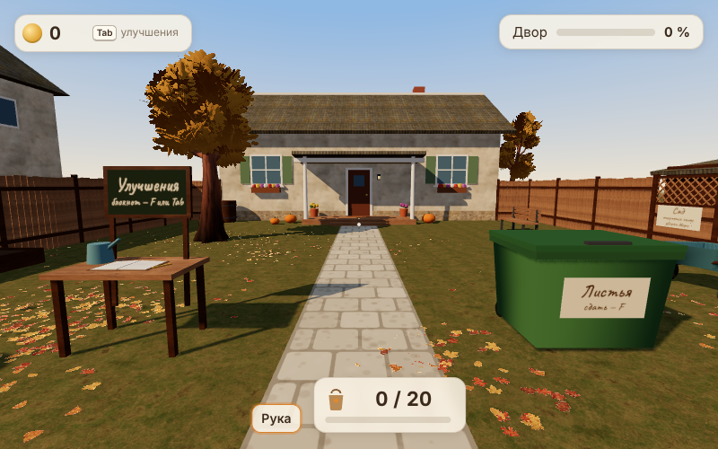

# Осенний двор

Уютная игра от первого лица: собираешь листья во дворе, сдаёшь их в контейнер, покупаешь улучшения.
Сейчас готов один двор — 6 400 листьев, ручной сбор, экономика в долларах по таблице Leaf it Alone, с готовыми моделями
деревьев и кустов и PBR-материалами — и отдельный режим для проверки внешнего вида листьев.



## Запуск

Сборка не нужна: three.js, шрифт и текстуры лежат в архиве.

**На Mac** — двойной щелчок по `start.command`. Он поднимает локальный сервер и открывает игру
в Safari по адресу **http://localhost:8080**. Закройте окно Терминала, чтобы остановить сервер.

- При первом запуске macOS может не дать открыть файл: правый клик по `start.command` → «Открыть» → «Открыть».
- Нужен `python3`. Если его нет, скрипт подскажет: `xcode-select --install`.
- Адрес не меняется. Браузер хранит сохранение отдельно для каждого адреса, поэтому скрипт не переходит
  на другой порт молча: если 8080 занят другой программой, он сообщит об этом и остановится. Если на 8080
  уже запущена эта игра, он просто откроет её.
- `start-fragment.command` открывает отдельный режим проверки листьев (`/?fragment`, без сохранения).

Вручную (любая система):

```sh
python3 -m http.server 8080 --bind 127.0.0.1
# открыть http://localhost:8080        — двор с сохранением
#         http://localhost:8080/?fragment — участок 6 × 6 м для проверки листьев
#         http://localhost:8080/?fresh&zone=garden — сад с нуля, без сохранения (только посмотреть)
```

Открывать `index.html` двойным щелчком нельзя: Safari не загружает модули и текстуры с `file://`.

## Управление

| Действие | Как |
|---|---|
| движение | WASD |
| обзор | трекпад или мышь (чувствительность и инверсия — в паузе) |
| подобрать | **клик** по листу под точкой — один сбор с учётом захвата |
| собирать подряд | **удерживать** кнопку — сбор повторяется с текущей скоростью |
| то же клавишей | E (нажатие и удержание; в настройках — режим включения и выключения) |
| сдать | F у зелёного контейнера (можно и неполный мешок) |
| инструмент | 1 — рука, 2 — грабли, 3 — воздуходувка (когда куплены), Q — по кругу |
| воздуходувка | **удерживать** кнопку — струя гонит листья от игрока |
| грабли | **удерживать** кнопку — взмахи подряд; листья тянутся к игроку |
| ворота в соседнюю зону | F у ворот (мешок должен быть пуст) |
| улучшения | Tab в любом месте или F у стола с блокнотом |
| пауза, свободный курсор | Esc |

- Отпускание кнопки прекращает повторение и отменяет незавершённый повторный подбор. Подбор, начатый
  самим нажатием, доводится до конца, иначе короткий клик не успевал бы собрать лист (подбор длится 0,6 с).
- Пауза, открытый блокнот и потеря фокуса окна останавливают сбор.
- Клик, которым захватывается курсор при входе в игру, и клики по меню и блокноту листья не собирают.
- В центре экрана только точка: над доступным листом она светлеет и чуть увеличивается, во время сбора
  вокруг неё заполняется тонкое кольцо. Инструкции — на стартовом экране и в паузе, раздел «Управление».
- Деньги, мешок и процент уборки — компактными счётчиками по краям. Над счётчиком мешка появляются
  «F сдать N» у контейнера и «Мешок полон» со стрелкой к контейнеру. Инструментов, которых ещё нет, не видно.
- Грабли видны в руках только когда выбраны. Полоса на земле показывает, что захватит следующий взмах.

Клавиши определяются по физическому положению, поэтому работают и в русской раскладке.

## Что есть в игре

**Сбор.** Лист под точкой подсвечивается; листья, которые заберёт захват, тоже. Во время подбора лист
дрожит и приподнимается, затем все собранные листья по очереди плавно летят к игроку и исчезают перед
глазами. В плотной куче выбирается верхний лист. Собранный лист сразу исключается из выбора и
учитывается один раз. Захват берёт ближайшие листья в радиусе 2,4 м, через препятствия — нет.

**Ходьба.** Игрок идёт поверх листьев: они не сдвигаются, только шуршат и коротко покачиваются.
Сдвинуть листья можно только граблями и воздуходувкой.

**Зоны.** Шесть зон, 98 400 листьев:

| Зона | Листьев | Что там | Приёмники |
|---|---|---|---|
| Двор | 6 400 | дом с крыльцом, дерево, скамейка, тачка, грядка, стол с блокнотом | — |
| Сад (за восточным забором) | 12 000 | сарай, большое дерево, грядка с тыквами, кусты | у дорожки $0, у сарая $3 |
| Площадка у гаража (южнее сада) | 16 000 | бетонная площадка, гараж, баскетбольное кольцо, качели | на площадке $3, у качелей $6 |
| Терраса с бассейном (восточнее) | 22 000 | настил с грилем и столом под зонтом, бассейн, шезлонги | у гриля $10, скиммер $15 |
| Сквер с лабиринтом (южнее террасы) | 24 000 | лабиринт из живой изгороди, теплица с дорожкой, скамейки, фонари | в лабиринте $20, у дорожки к теплице $25 |
| Аллея (на юге) | 18 000 | дорожка между двумя рядами лип, скамейки, фонари | стоки в обоих концах $0 |

Каждая следующая зона открывается наградой за полностью убранную предыдущую: F у ворот, мешок должен быть пуст.
Переход сохраняет игру и загружает другую зону (листья лежат только в текущей; соседние видны через решётку
ворот и над забором). Деньги, покупки и бонусы общие; каждая зона помнит свои листья. Назад можно вернуться
теми же воротами. Цены приёмников — по таблице Leaf it Alone; стоков аллеи в таблице нет — они бесплатные,
иначе 18 тыс. листьев аллеи пришлось бы носить мешками за 20 м.

**Грабли** ($7,49, по таблице Leaf it Alone). Голова ставится в точку взгляда — не дальше 0,65 длины черенка —
и за взмах (0,42 с) протягивается к игроку на 0,62–0,70 м. Листья в полосе шириной 0,9–1,2 м (в таблице —
радиус 0,45–0,60 м) сгребаются в валик перед зубьями; доля листьев, которые идут за граблями, — «Цепкость»
80–100 %, остальные сдвигаются меньше. Сдвинутые листья ложатся поверх кучи и едут на экране вместе с
головой граблей. Сквозь забор, сарай и стволы листья не протаскиваются. Три ветки улучшений — по таблице:
длина черенка ($3,50 / $6,00 / $8,50 / $11,00), ширина захвата ($4,00 / $6,75 / $9,50 / $12,25 / $14,00),
цепкость ($5,00 / $6,50 / $8,00 / $9,50); каждая ступень по порядку и только после покупки граблей.

**Воздуходувка** ($49,99, по таблице). Пока кнопка удерживается, струя набирает силу (разгон 0,6–0,2 с по
мощности) и гонит листья от игрока: у сопла быстрее, к концу струи медленнее — листья собираются валом, и вал
можно гнать дальше, идя следом. Дальность 1,7–2,8 м и скорость растут с мощностью, ширина струи у сопла —
0,55–0,75 м, «Точность» уменьшает разброс. Лист, прижатый струёй к забору или стене, скользит вдоль него;
в бассейн листья не залетают. Ветки по таблице: ширина потока ($28 / $35 / $40 / $46 / $50), мощность
($15 / $20 / $24 / $27), точность ($10 / $16 / $21 / $25). Видна в руках только когда выбрана, под струёй —
едва заметная трапеция, во время работы — штрихи воздуха и звук мотора.

**Приёмники.** Решётки в земле. Куча, протащенная граблями или загнанная воздуходувкой над решёткой,
проваливается в неё и продаётся сразу по текущей цене листа, без мешка и контейнера. Бесплатные работают
сразу, платные покупаются в блокноте, когда есть грабли или воздуходувка и зона открыта; некупленный закрыт
деревянной крышкой.

**Листья.** Готовые текстуры из `assets/leaves/` — шесть видов: клёны, дубы, бук, берёза. Исходник лежит
в `assets/leaves/source/`, атлас из него собирает `tools/build-leaf-atlas.py`:
- каждый лист выделяется по фактическим границам, края не обрезаются;
- отдельные крапинки на фоне отбрасываются, красно-оранжевая кайма вокруг контура убирается;
- цвет листа протягивается под прозрачную область, поэтому на мипмапах нет тёмного ободка;
- цвет (`leaf-color.jpg`) и маска прозрачности (`leaf-alpha.png`) хранятся раздельно, чтобы браузер
  не портил цвет края при загрузке.

Лист — тонкая поверхность с несколькими умеренными изгибами (края, кончик, лёгкое скручивание, волна
вдоль листа), двусторонняя, с alphaTest. Размеры различаются на ±18 %. Насыщенность немного приглушена.

Каждый лист лежит либо на земле, либо на листьях под ним: высота считается по тому, что действительно
лежит ниже. Лист на земле почти плоский, на других листьях наклонён сильнее, но край не уходит в землю.
Когда нижние листья собраны, верхние плавно опускаются, а не висят в воздухе. Тени — по форме листа,
круглых пятен и чёрных контуров нет; накрытые листья чуть темнее, поэтому перекрытия читаются.

Распределение — скопления у забора и дома, под деревом и несколько «наносов» с плавным спадом
к редким листьям и чистому газону. На дорожке листьев меньше.

**Двор.** Дом с крыльцом, дорожка, газон, высокий дощатый забор (с уровня глаз за ним не видно пустого
поля), ворота в сад с решёткой, скамейка, тачка, грядка с кустами, бочка, тыквы. Зелёный контейнер и стол
с блокнотом улучшений видны со старта. Во дворе — лиственное дерево, за забором — ещё три дерева и крыши
соседей. Листья лежат кучами: у забора и дома, под деревом и в нескольких «наносах»; между ними газон чище.

В каждой зоне свой контейнер у входа. Плотность ковра по зонам — `node tools/zone-plan.mjs`.

**Готовые ресурсы двора** (`assets/yard/`, подробности и ссылки — `assets/yard/README-RU.md`):
- модели Quaternius (CC0): два дерева и куст. Высота нормализована по габаритам: деревья 5,2–6 м, кусты
  0,7–1,05 м. Копии делят геометрию и материалы. Листва окрашена в осенние тона: адаптер
  `autumn-foliage.js` встроен в `src/view/yardAssets.js` и создаёт один материал на оттенок, кору не трогает,
  прозрачность сохраняет;
- PBR-материалы Poly Haven (CC0): штукатурка — стены, камень — цоколь, черепица — крыши, дуб — забор,
  крыльцо и деревянные детали, газон — земля. Один общий `MeshStandardMaterial` на вид поверхности,
  карты рельефа без смещения геометрии. Текстура повторяется по метрам поверхности, а не растягивается на
  объект. Цвет подстроен под стилизованную сцену: штукатурка светлее, газон чуть зеленее, чтобы на нём
  читались листья;
- `GLTFLoader` той же версии three.js (0.170) лежит в `vendor/jsm/`;
- если какой-то файл не загрузится, двор строится с запасными материалами, а ошибка выводится в консоль.

Коллизии и места листьев ресурсы не меняют: кусты стоят в грядке и в саду, дерево — на месте прежнего.

**Деньги — доллары.** Баланс начинается с $0,00; в интерфейсе всегда два знака после запятой. Внутри деньги
хранятся целыми единицами по $0,0001: лист стоит 40 единиц ($0,004), после бонуса +25 % — 50 ($0,005).
Сдачи не округляются до центов, дробный остаток сохраняется: пять сдач по листу дают столько же, сколько
одна сдача пяти. Доход начисляется только при сдаче: 50 листьев — $0,20, 200 — $0,80, 500 — $2,00, а после
бонуса — $0,25 / $1,00 / $2,50. Баланс показывается с отбрасыванием долей цента, поэтому не завышается.

**Награды зон.** Зона убрана на 50 % (с листьями в мешке) — цена листа +25 % навсегда; бонусы зон
складываются (после всех шести зон лист стоит $0,01). Награда выдаётся один раз и сохраняется. Зона на 100 % —
открывается следующая; аллея на 100 % — участок убран целиком.

**Покупки — по таблице Leaf it Alone** (`src/config.js`). Каждая ступень покупается отдельно и по порядку,
цена списывается точно:

| Ветка | Ступени | Цены |
|---|---|---|
| Жадная хватка (листьев за подбор) | 1 → 2 → 3 → 5 → 7 → 10 | $0,10 / $0,50 / $1,75 / $3,50 / $5,75 |
| Ловкость (время подбора) | 0,50 → 0,43 → 0,37 → 0,31 → 0,25 → 0,20 с | $0,25 / $0,75 / $1,50 / $2,75 / $4,50 |
| Мешок | 50 → 200 → 500 листьев | $0,75 / $3,49 |

Покупки сразу меняют работу: сколько листьев берёт подбор, сколько он длится, сколько входит в мешок.
Сбор удержанием бесплатен с начала, Fluid Picker не продаётся. Грабли и приёмники — см. выше.
Воздуходувка и её ветки — см. выше.

**Сохранение.** Хранится в браузере (`localStorage`) для адреса http://localhost:8080. В нём покупки,
деньги, инструменты и приёмники, содержимое мешка, текущая зона, для каждой посещённой зоны — какие листья
убраны и куда сдвинуты граблями (позиции только у сдвинутых: сад целиком — 12–330 КБ), подсказки,
настройки и позиция. Сохранения версии 3 (доллары, один двор) загружаются без потерь. Сохраняется после сдачи,
покупки, изменения настроек, каждые 10 секунд уборки, при паузе, скрытии вкладки и закрытии страницы.
В паузе есть экспорт в файл, восстановление из файла и сброс с подтверждением. Восстановление сначала
проверяет файл, затем записывает его и читает обратно; если запись не удалась, страница не
перезагружается и показывается ошибка.

При загрузке баланс проверяется: деньги = заработано − стоимость всех покупок (ступени, грабли, приёмники),
заработок не может превышать «все проданные во всех зонах листья по цене с бонусами», бонус засчитывается,
только если порог уборки его зоны действительно пройден, приёмники — только известные и только при граблях.

**Сохранения прежней экономики (монеты).** Монеты не пересчитываются в доллары один к одному. При запуске
игра показывает выбор: «Экспортировать прежний прогресс» (файл JSON) или «Начать заново с $0,00» с
подтверждением. До выбора прежнее сохранение не перезаписывается. После нового старта его копия остаётся в
браузере (`leaf-yard-save-legacy-backup`). Файл прежней версии в «Восстановить из файла» не загружается — с
понятным сообщением.

## Экономика (`npm run economy`)

Вся доступная сейчас прокачка (хватка, ловкость, оба мешка) стоит **$25,59**. Под неё рассчитано число
листьев: 6 400. Половина двора продаётся по $0,004, вторая — по $0,005, поэтому за двор выходит около $28,85.
Этого хватает на всю прокачку при любом порядке покупок с запасом $3,26. Первая покупка ($0,10 или $0,25)
доступна сразу после первой сдачи полного мешка ($0,20).

| Стратегия | Время уборки | Ходок | Заработано | Потрачено |
|---|---|---|---|---|
| без покупок | 95:12 | 128 | $28,85 | $0,00 |
| самое дешёвое сначала | 16:04 | 31 | $29,00 | $25,59 |
| только хватка | 18:42 | 128 | $28,85 | $11,60 |
| только мешок | 91:30 | 20 | $29,30 | $4,24 |
| случайные порядки (60 прогонов) | 14:57 … 18:57 | | ≥ $28,85 | |

Модель времени грубая (ходьба, прицеливание, подбор по таблице), но одинаковая для всех стратегий.
На грабли ($7,49) одного двора не хватает — их покупают в саду.

**Инструменты и вся игра** — замеры ботами на коде игры, подробно в `docs/zones-plan.md`:
`node tools/rake-sim.mjs` (грабли), `node tools/blower-sim.mjs` (воздуходувка),
`node tools/campaign-sim.mjs` (прохождение шести зон с покупками по мере денег). Бот сразу знает, куда гнать
кучу, поэтому у человека времени уйдёт больше.

## Проверки

```sh
npm test               # логика: доллары и цены по таблице, дробные остатки, бонус, листья, сохранения
npm run economy        # симуляция уборки двора при разных порядках покупок
node tools/rake-sim.mjs      # скорость граблей в саду и на площадке (бот на коде игры)
node tools/blower-sim.mjs    # скорость воздуходувки на террасе
node tools/campaign-sim.mjs  # прохождение всех зон ботом (несколько минут)
node tools/zone-plan.mjs     # листья, площадь и плотность ковра по зонам
node tools/smoke.mjs         # сквозной тест в браузере (нужен сервер на 8080 и playwright)
node tools/smoke-zones.mjs   # все шесть зон: ворота, грабли, приёмник, воздуходувка, сохранение
```

`npm test` нужен только Node.js (18+). `tools/smoke.mjs` проверяет:
- клик и удержание; отпускание с отменой повторного подбора;
- клики захвата курсора и в блокноте, которые не собирают листья;
- ходьбу без сдвига листьев, сдачу и покупку;
- восстановление денег, покупок, мешка и каждого убранного листа после закрытия и повторного открытия;
- импорт при сбое записи в хранилище, паузу и потерю фокуса;
- баланс в долларах после сдачи и точное списание цены покупки;
- выбор для сохранения прежней экономики: экспорт, новый старт с подтверждением, резервная копия.

Дополнительно, по желанию: `tools/screenshots.mjs` и `tools/fragment-shots.mjs` снимают кадры
(в программном рендере это долго), `tools/build-leaf-atlas.py` пересобирает атлас (нужны Pillow и numpy).

## Производительность

- Листья — один instanced-меш, поэтому их число почти не влияет на число вызовов отрисовки. Тени листьев
  считаются для всего меша.
- Замер в Chromium (программный рендер, только как ориентир по нагрузке, не FPS):

  | Вид от входа в зону | Вызовов отрисовки | Треугольников |
  |---|---|---|
  | двор (со старта) | ~250 | 235 тыс. (листья 6 400 × 32) |
  | сад | ~110 | 403 тыс. (12 000 × 32) |
  | площадка у гаража | ~340 | 613 тыс. (16 000 × 32) |
  | терраса | ~160 | 425 тыс. (22 000 × 18) |
  | сквер | ~300 | 525 тыс. (24 000 × 18) |
  | аллея | ~50 | 624 тыс. (18 000 × 32) |

  Все зоны строятся всегда (одна видна из другой), листья — только в текущей. В зонах больше 20 тыс. листьев
  лист рисуется сеткой 3 × 3 (18 треугольников) вместо 4 × 4 (32): изгиб чуть грубее, но вдвое легче.
- Модели и материалы весят около 19 МБ; самые тяжёлые — текстуры коры 2048 px.
- Частота кадров: «Показывать частоту кадров» в паузе или `?fps` в адресе.
- Замер допустимого числа листьев: `http://localhost:8080/?leaves=5000` (затем 10000 …). Прогресс в этом
  режиме не сохраняется и не трогает основное сохранение.
- Если не хватает плавности — выключить тени в паузе.

Плавность на Mac M1 в Safari пока **не проверена**: это нужно сделать на месте. Самые тяжёлые места —
площадка у гаража и сквер (больше всего вызовов отрисовки) и аллея (больше всего треугольников).

## Чего пока нет

- Плющ на заборе, живая изгородь и пучки травы — в комплекте их нет.
- Модели без фирменных шейдеров автора: вид отличается от рекламного превью Quaternius.
- Листья на воде бассейна — только неподвижные, для вида; в воду листья не попадают.
- Внутрь теплицы и гаража не войти.

## Структура

```
index.html, style.css           страница, HUD, блокнот, пауза
start.command                   запуск на Mac (двор), start-fragment.command — режим проверки листьев
src/config.js                   таблицы улучшений и константы
src/layout.js                   зоны и фрагмент: препятствия, поверхности, ворота, приёмники, плотность листьев
src/leaves.js                   листья: генерация, состояния, укладка слоями, захват, сдвиг
src/rake.js, src/blower.js      взмах граблей, такт струи воздуходувки (чистая логика)
src/economy.js                  мешок, сдача, приёмники, покупки, проверка сохранения по всем зонам
src/game.js, src/save.js        создание игры, сохранение, перенос старых сохранений
src/main.js                     цикл игры, управление, состояния
src/ui.js, src/audio.js         интерфейс и звук
src/view/                       сцены зон (scene, garden, court, pool, park), инструменты (rakeView, blowerView),
                                фрагмент, земля, листья
assets/leaves/                  атлас листьев; source/ — исходный лист текстур
assets/yard/                    модели Quaternius и материалы Poly Haven (CC0), их README и лицензии
src/view/yardAssets.js          загрузка ресурсов двора, осенняя окраска листвы, UV в метрах
vendor/                         three.js 0.170, GLTFLoader (vendor/jsm) и шрифт Caveat (лицензии рядом)
test/, tools/                   тесты, боты-замеры (bots.mjs, flow.mjs), браузерные проверки, сборка атласа
```
