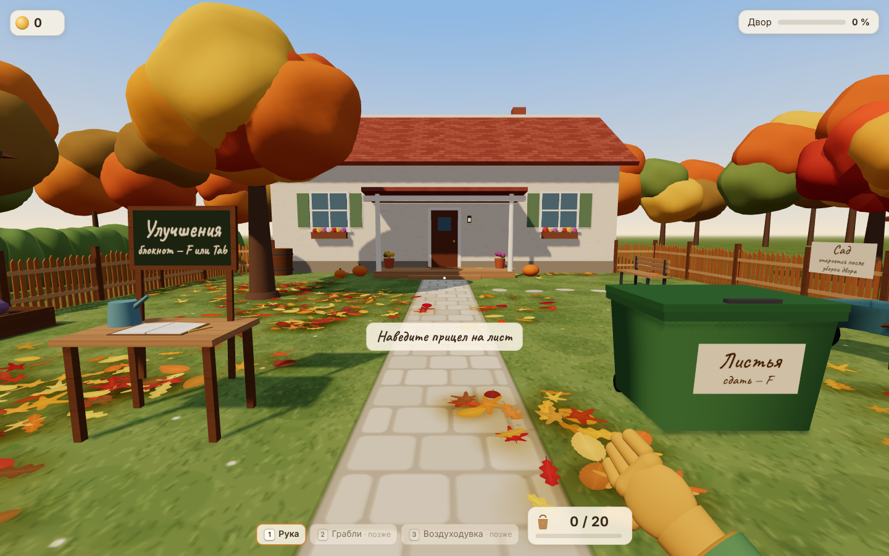
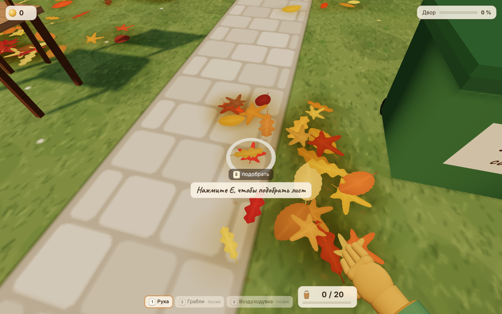
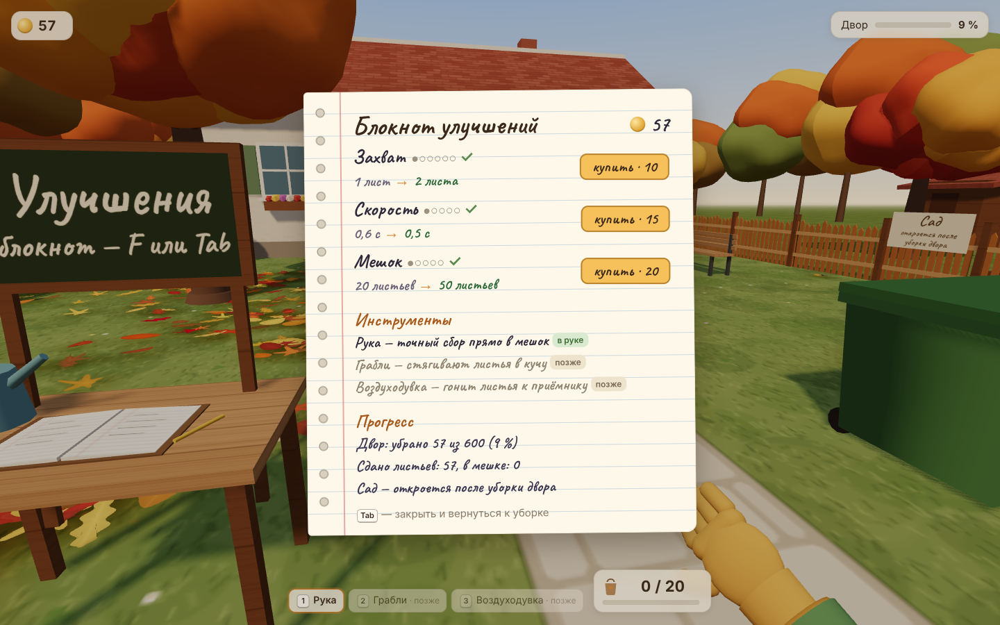
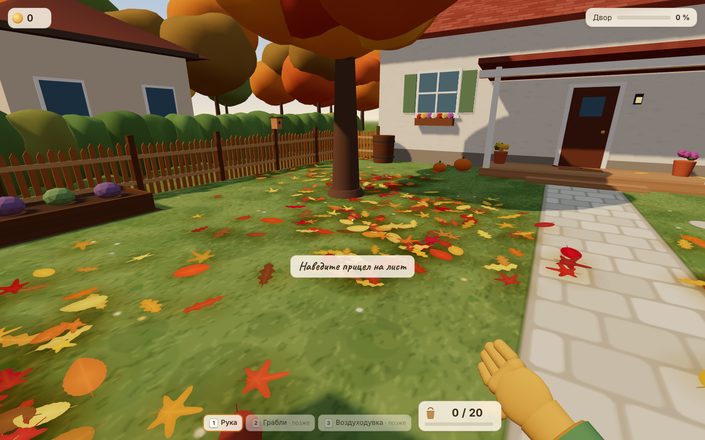
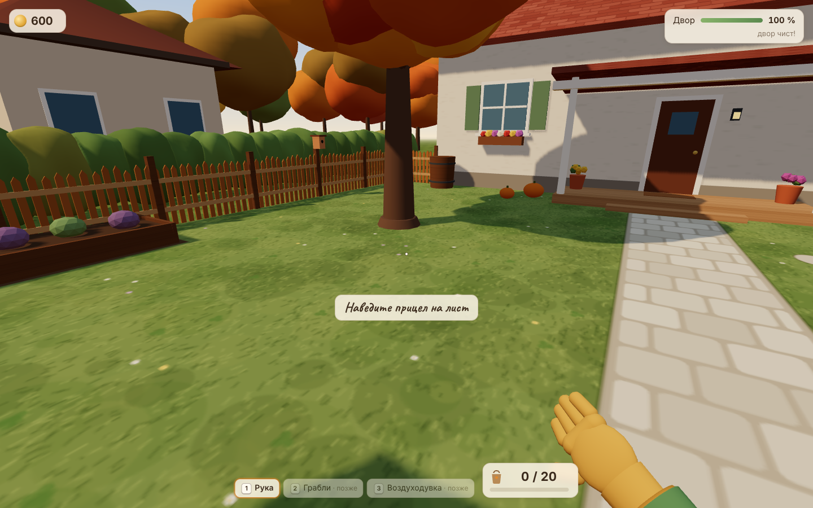

# Осенний двор — первая версия

Уютная игра от первого лица: собираешь листья во дворе, сдаёшь их в контейнер, покупаешь улучшения.
Это первый результат для оценки по ТЗ: **один участок на 600 листьев с ручным сбором и работающей прокачкой**,
в реальном игровом виде (модели, свет, интерфейс).



## Запуск

Сборка не нужна, внешних зависимостей нет: three.js и шрифт лежат в `vendor/`.

```sh
python3 -m http.server 8080
```

Затем откройте в Safari `http://localhost:8080`. Открывать `index.html` двойным щелчком нельзя:
Safari не загружает ES-модули с `file://`.

## Управление

| Клавиша | Действие |
|---|---|
| WASD | движение |
| трекпад / мышь | обзор (чувствительность и инверсия — в паузе) |
| E | подобрать лист; удержание повторяет сбор. В настройках можно включить «включение одним нажатием» |
| F | сдать листья у контейнера / открыть блокнот у стола |
| 1 / 2 / 3 | инструмент (грабли и воздуходувка пока закрыты) |
| Tab | блокнот улучшений и прогресс |
| Esc | пауза и освобождение курсора |

Клавиши определяются по физическому положению (`KeyboardEvent.code`), поэтому работают и в русской раскладке.

## Что сделано

**Ручной сбор.** Лист под прицелом подсвечивается кольцом, листья, которые заберёт захват, отмечены точками.
Во время подбора вокруг прицела заполняется кольцо, перчатка тянется к листу, затем листья летят в руку
с шорохом. Захват берёт ближайшие листья вокруг выбранного (радиус 2,4 м), через препятствия — нет.
Если места в мешке меньше, чем размер захвата, берётся сколько помещается. При полном мешке — спокойная
подсказка, стрелка над контейнером и указатель направления.

**Цикл и прокачка.** Таблицы захвата, скорости и мешка — ровно как в ТЗ (`src/config.js`). Сдавать можно и
неполный мешок. Покупка сразу меняет поведение: заметно по числу подсвеченных листьев, скорости кольца и
шкале мешка.

**Двор.** Дом со штукатуркой и крыльцом, дорожка, газон, деревянный забор, дерево, скамейка, тачка, грядка,
бочка, поилка, тыквы и хризантемы. Контейнер и стол с блокнотом видны с начальной позиции, первые листья
лежат между ними. За восточным забором виден сад со следующей зоной (табличка «откроется после уборки двора»),
за изгородью — соседний дом, на юге — улица.

**Листья.** Три формы (клён, берёза, дуб) × два варианта изгиба, семь оттенков с небольшим разбросом, разные
размеры и повороты, светлая центральная жилка. Скопления у забора, дома, под деревом и в нескольких «наносах»,
редкие листья на дорожке, чистые промежутки. Листья лежат слоями на разной высоте, чтобы не мерцать.
При ходьбе листья под ногами чуть сдвигаются, поворачиваются и подлетают.
Под лежащими листьями трава пожухлая; после уборки открывается свежий газон, плитка, клевер и цветы.

**Интерфейс.** Маленький прицел, внизу мешок «12 / 20» и выбранный инструмент, слева вверху деньги
(с анимацией «+20» при сдаче), справа — процент очистки двора. Подсказки обучения (подобрать → сдать →
купить) появляются по ходу и исчезают после освоения. Магазин — садовый блокнот: улучшение, текущее → следующее
значение, цена, кнопка; недоступные покупки читаются, но показывают, сколько не хватает.
Последние 12 листьев подсвечиваются (можно выключить).

**Звук.** Синтезируется через Web Audio, без файлов: шорох подбора и шагов по листьям, сдача, покупка,
тихий ветер и птицы. Отдельные регуляторы общей громкости, эффектов и фона.

**Сохранение.** В `localStorage`: покупки, деньги, мешок, состояние и положение каждого листа, открытые зоны,
подсказки, настройки и позиция игрока. Сохраняется после сдачи, покупки, изменения настроек, каждые 10 секунд
уборки, при паузе, скрытии вкладки и закрытии страницы. В паузе — экспорт в файл, восстановление из файла
и сброс прогресса с подтверждением.

## Гарантии из «условий готовности»

Источник правды — состояние каждого листа: на земле → в мешке → сдан. Мешок и заработок вычисляются из него.

- Лист нельзя собрать или продать дважды: переход состояния только вперёд.
- Покупка списывает точную цену и поднимает уровень ровно на 1; баланс не уходит в минус, мешок не переполняется.
- При загрузке деньги пересчитываются как «сдано − потрачено»; подделанные или испорченные данные исправляются.
- Листья не появляются в препятствиях, за забором и под землёй; сдвиг листа ногами не может увести его туда же.
  Тест проверяет, что каждый из 600 листьев можно подобрать с какой-то доступной точки.
- Пауза, открытый магазин и потеря фокуса останавливают сбор и движение.

## Проверки

```sh
npm test                 # логика: экономика, листья, сохранение, достижимость (node, без браузера)
npm run economy          # симуляция уборки двора при разных порядках покупок
node tools/smoke.mjs     # сквозной тест в браузере: E → F → покупка → перезагрузка → пауза
node tools/screenshots.mjs   # контрольные кадры в docs/screenshots/
```

Для `smoke.mjs` и `screenshots.mjs` нужен запущенный сервер на 8080 и установленный playwright.

### Экономика (результат `npm run economy`)

Весь двор — 600 монет, вся таблица прокачки — 2625, как и задумано: на первом участке её не пройти.
Первая покупка доступна сразу после первой сдачи полного мешка (20 монет ≥ 10 или 15 или 20).

| Стратегия | Время уборки | Ходок к контейнеру | Потрачено |
|---|---|---|---|
| без покупок | 10:58 | 30 | 0 |
| самое дешёвое | 3:20 | 11 | 525 |
| только захват | 4:03 | 30 | 450 |
| только мешок | 10:03 | 7 | 320 |
| только скорость | 8:34 | 30 | 255 |
| случайные порядки (200 прогонов) | 3:07 … 7:29, медиана 3:46 | | |

Модель времени грубая (ходьба, прицеливание 0,35 с, подбор по таблице), но одинаковая для всех стратегий.
Выбор между «эффективнее собирать» и «реже ходить» работает: только мешок даёт меньше всего ходок,
но почти не ускоряет уборку.

## Производительность

Проверить на целевом Маке нужно вручную — у меня нет доступа к Safari на M1.

- Частота кадров: «Показывать частоту кадров» в паузе или `?fps` в адресе.
- Замер допустимого числа листьев: `http://localhost:8080/?leaves=3000` (затем 6000, 10000 …).
  В этом режиме прогресс не сохраняется и не трогает основное сохранение.
- Если не хватает плавности: выключить тени в паузе. Чёткость — до 2× пикселей экрана.

Листья рисуются шестью instanced-мешами, поэтому их число почти не влияет на число вызовов отрисовки.

## Кадры для оценки

| | |
|---|---|
|  Крупный план: подсветка, кольцо подбора, перчатка |  Открытый блокнот улучшений |
|  Участок до уборки |  Тот же участок после уборки |

Кадры сняты в headless Chromium с программным рендером: освещение и сглаживание в Safari будут немного отличаться.

## Структура

```
index.html, style.css     страница, HUD, блокнот, пауза
src/config.js             таблицы улучшений и константы
src/layout.js             планировка двора, препятствия, столкновения, видимость
src/leaves.js             поле листьев: генерация, состояния, захват, сдвиг
src/economy.js            мешок, сдача, покупки, проверка сохранения
src/game.js, save.js      создание игры, сохранение, экспорт и восстановление
src/main.js               цикл игры, управление, состояния, подсказки
src/ui.js, audio.js       интерфейс и звук
src/view/                 сцена, земля, листья, перчатка, процедурные текстуры
test/, tools/             тесты, симуляция экономики, браузерные проверки
```

## Дальше по плану ТЗ

Грабли и кучи с приёмником, воздуходувка и проверка нагрузки, зоны (крыльцо, двор, сад, хозяйственная часть),
затем полное прохождение. Цены новых инструментов рассчитываем от заработка и оставшихся листьев
через `tools/economy-sim.mjs`.
